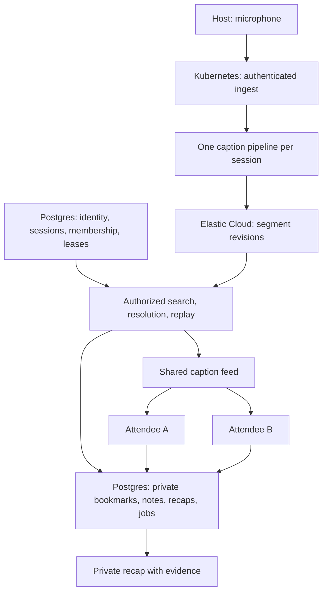
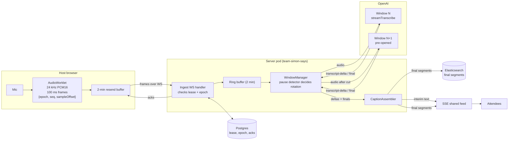

# Architecture

Confirmed: Next.js on Kubernetes operated through Radar, Prisma for PostgreSQL, and Track 2's transcription provider, adapter direction, and Elasticsearch core-content-store split. The remaining product runtime design below is proposed. See [decisions](decisions.md) for choices requiring validation.

## Data flow

## Monorepo ownership

The workspace uses pnpm, one lockfile, and `workspace:` dependencies. `packages/contracts` holds runtime boundary schemas and `packages/domain` holds pure timeline rules; their READMEs list the modules. Some paths and responsibilities in the table describe planned work.

The [building tracks](https://app.shortcut.com/simon-says/write/IkRvYyI6IjZhZjIzNzlmLWMzMDMtNGUwYy1hOTBhLWM4MzJjZGU3ZDQwNSI=) divide feature ownership, including the UI/capture boundary and shared migration coordination.

| Path                  | Owns                                                                                                          |
| --------------------- | ------------------------------------------------------------------------------------------------------------- |
| `apps/web`            | Next.js App Router, host and attendee UI, browser capture, server routes, and Node.js runtime                 |
| `apps/web/src/server` | Authentication, ingest, caption delivery, provider adapters, Elasticsearch ingest and reads, and durable jobs |
| `packages/ui`         | shadcn/ui components, theme, shared presentation primitives                                                   |
| `packages/contracts`  | Runtime request/event schemas and derived TypeScript types                                                    |
| `packages/domain`     | Pure timeline, selection, alignment, and revision rules                                                       |
| `packages/db`         | Prisma schema and client; planned migrations, repositories, and synthetic seeds                               |
| `infra`               | Local services, deployment definitions, telemetry configuration                                               |
| `tests/fixtures`      | Authorized audio, expected words and timestamps                                                               |
| `tests/e2e`           | Host/attendee flows and cross-user isolation checks                                                           |

One Next.js application owns the UI and backend. HTTP endpoints use App Router Route Handlers; capture and interactive captions use Client Components. `domain` and `contracts` have no UI, database, or provider dependencies. Only server code imports `db` or server provider SDKs. Mark server modules with `server-only`. Keep application-specific components in web.

## Kubernetes runtime

Deploy the existing Next.js app as a Node.js container. Radar supplies cluster visibility, investigations, and deployment operations; Kubernetes runs the app. Keep product HTTP APIs in Route Handlers. A custom Node entry point serves health/transport probes, WebSocket upgrades, and Next.js HTTP, explicitly compiled and packaged without standalone output. Do not assume a Route Handler supports upgrades outside Vercel.

Start with one application replica, but keep all leases, replay cursors, audio acknowledgments, and transcript progress durable. Rolling deployments can overlap pods. Reconnect with backoff, replay frames the host still holds, deduplicate overlap, and preserve the source clock. Pod termination must not end a session; audio beyond host resend capacity becomes a visible gap while raw-audio persistence is deferred. Keep missing audio distinct from missing transcript.

Propose a Postgres event log with bounded polling for cross-pod SSE delivery. Notification mechanisms may reduce latency but cannot replace durable replay. The gateway must pass WebSocket upgrades and unbuffered SSE. Bound payload sizes, connection counts, and backpressure; keep authorization at each boundary.

Use CloudNativePG for cluster Postgres via Prisma. Elasticsearch on Elastic Cloud Serverless (hackathon trial) owns shared transcript revisions. The team cluster budget (2 CPU / 4 GiB requests, 4 CPU / 8 GiB limits total) cannot fit Elasticsearch next to the app and Postgres. Use runtime Secrets and explicit migration Jobs. See the [deployment plan](deployment.md) for packaging, rollout, and teardown gates.

Recap generation runs as durable Postgres jobs on [pg-boss](decisions.md#confirmed-by-the-track-3-owner) inside the app's Node process, with retries, per-job expiry, and a dead-letter queue; see the [recap contract](contracts.md#track-3-payloads). The custom server starts one pg-boss instance per pod (`apps/web/src/server/jobs/runtime.ts`) and stops it in the SIGTERM drain; Next route handlers enqueue through that instance inside their Prisma transaction. Source cleanup will use the same bootstrap with a cron schedule, and its progress must survive interruption. Never rely on an unawaited promise or pod-local files for durable work.

## Search and observability

Elasticsearch is the system of record for shared source content from milestone 1: every finalized transcript segment revision with live/corrected/repaired provenance. Track 2 writes these during ingest. Postgres owns identity, sessions, membership, host lease/epoch, audio acknowledgments, finalized-transcript offset, bookmarks, notes, recaps, and job queue. No private data or identity-linked search queries enter Elasticsearch.

Track 3 resolves bookmarks by `startMs`/`endMs` on the session clock against Elasticsearch, filtered to segment revisions. Fixed requested ranges never move when later content arrives. Track 3 also implements “Find the Right Talk” keyword search plus `semantic_text` over segments; track 1 owns its UI. The embedding endpoint is `.jina-embeddings-v5-text-small`. Results resolve to source ranges that attendees explicitly keep as paragraph-anchored selections; search never adds evidence automatically.

Every Elasticsearch read, including search, resolution, and replay, checks current membership and access in Postgres first, including after revocation. Apply source revision, redaction, and expiry guards before returning content. Durable cleanup jobs remove expired/redacted/deleted documents and prevent retries restoring them. Materialize selected evidence before shared-source expiry.

Use idempotent document IDs based on session, epoch, segment ID, and revision. Elasticsearch persistence is part of durable source acknowledgment. Write ordering across Elasticsearch, the Postgres finalized offset, audio acknowledgments, and replay events, including crash recovery, must be settled before source acknowledgment counts as durable. An Elasticsearch outage visibly degrades captions; retain/retry source content or expose a gap, never silently drop it. A search-only failure leaves captions and saved evidence usable when the content store is healthy.

Export content-free OpenTelemetry from the Node runtime, including its jobs, to Dash0. Allowlist attributes and suppress captured text, queries, notes, model prompts, credentials, and signed URLs. Disable content-bearing automatic instrumentation. Radar handles cluster operations; Dash0 handles application traces and metrics. The [hackathon plan](https://app.shortcut.com/simon-says/write/IkRvYyI6IjZhZjIzNzc1LTA2YmQtNDllNS04NjZhLTg0NmY2NTczYzk5NyI=) defines evidence and ownership for all four tracks.

## Transcription and text passes

**Plan B, confirmed by Dylan on November 9, 2026:** OpenAI only, using hackathon credits. Live captions use `gpt-realtime-whisper` through server-only `ai` 7.0.x `experimental_streamTranscribe` and `@ai-sdk/openai` 4.0.x `openai.transcription(model)`. `gpt-live-transcribe` is a same-price config swap. See [pricing and SDK evidence](decisions.md#confirmed-by-the-track-2-owner).

**Host capture:** `getUserMedia` with echo cancellation, noise suppression, and AGC off; `AudioContext({sampleRate: 24000})`; an AudioWorklet emits 2,400-sample (100 ms) PCM16 frames with `{epoch, seq, sampleOffset}`. `sampleOffset / 24` gives source-clock milliseconds. Retain a two-minute resend buffer and reconnect with backoff.

**Ingest:** the custom Node server owns WebSocket ingest, Postgres lease/epoch checks, a two-minute ring buffer, and batched acknowledgments. A duplicate `seq` in the same epoch with the same checksum is acked idempotently; changed content conflicts. Raw-audio persistence is deferred today. Acknowledgments confirm receipt into the ring buffer, not durable storage; the [contracts](contracts.md#live-caption-ingest-and-events) define this and mark the AudioChunk record deferred.

**WindowManager:** the SDK commits once when input closes and ends at its first final, so run successive windows. Rotate at the first pause of at least 300 ms after 15 s, or 150 ms after 20 s; after 25 s cut at the first quiet unit or speech low point, with a hard cut at 27 s. Pre-open N+1 about 1 s early. Frames from the cut go to N+1; closing N's input commits it. Keep pause detection, rotation planning, and timing estimation pure in `packages/domain`; the SDK call lives in `apps/web/src/server/captions/`.

**CaptionAssembler:** deltas become interim text over SSE only, with estimated audio time per delta (offset sent minus measured lag). The final replaces interim text. Split it into sentences with estimated ranges (about ±1–2 s, `timing: { kind: "estimated", uncertaintyMs }`), writing revision 1 to Elasticsearch with provenance `live` and idempotent ID `sessionId:epoch:segmentId:revision`. Publish captions in window order. Persist final content before advancing the Postgres finalized offset or publishing durable final events; settle cross-store ordering and crash recovery in milestone 1.

**Failures:** replay a failed window from the ring buffer up to two retries, then emit a gap event `[startMs, endMs]`. On host drops, the host resends frames the server has not acknowledged. Acknowledgment is receipt into the server ring buffer, not durable storage (see [contracts](contracts.md#live-caption-ingest-and-events)), and the host discards acknowledged frames. So on pod restart, acknowledged audio that was not yet finalized is lost: the new pod resumes transcription at the first frame the host still holds and emits a `caption.gap` (`audio_missing`) from the last finalized offset to that frame. Do not claim acknowledged audio survives restart without durable bytes. Show lag in caption health and Dash0.

**Limits and validation:** no live vocabulary hints: streaming prompt and keywords warn as unsupported. There are no SDK segment timestamps (`segments: []`); timing is estimated. Use one replica for in-process SSE fan-out; multiple replicas require the shared event source described above, including during rolling overlap. Unmeasured on the real provider: session length limits, faster-than-realtime replay, final/delta differences, latency per `delay`, and rate limits. Start `providerOptions.openai.streaming.delay` at `low`; supported choices are `minimal|low|medium|high|xhigh`. Test pure domain logic and fake transcription models without a key; make the first real call in the cluster with the key in the Secret.

**Dash0:** one span per window; content-free interim and final caption lag, rotation gap, window duration, retries, errors, ingest backlog, reconnects, and Elasticsearch write latency. Never audio, text, or prompts.

**Proposed caption correction, milestones 2–3:** OpenAI through the AI SDK, using the cheapest OpenAI model that passes the check, chosen at implementation. Correct finalized captions asynchronously with new `corrected` revisions and preserved originals, off the live caption path. Transcript text is untrusted data, never instructions.

### S3 development implementation

S3 implements Plan B in `apps/web/src/server/captions/`: OpenAI `gpt-realtime-whisper` through AI SDK `experimental_streamTranscribe`, at 24 kHz PCM16 mono. `openai-window.ts` accepts an injected transcription model. One call owns one window: the SDK commits when input closes and ends at its first final. `window-manager.ts` preopens the successor, partitions samples at domain-planned cuts, and retries a failed window twice from `ring-buffer.ts`. The ring retains up to 120 seconds and 6,000 frames. Lag is an EMA seeded at 800 ms using delta arrival minus latest audio pull as a proxy, not a measured word alignment.

`assembler.ts` estimates interim/sentence times using domain rules and serializes final publication by window index. `segment-sink.ts` defines the persistence boundary; finals publish only after `writeSegments` resolves. The configured Elasticsearch sink is described below; the bounded in-memory fallback is development-only. A failed sink emits degraded `capture.state` (`segment_sink_failed`) and an exact-range `caption.gap`, without a final; subsequent windows may continue. Production acceptance still requires deployed Elasticsearch verification and reconciliation with Postgres progress.

`transport.ts` mounts host WebSocket `/api/sessions/:id/ingest` and SSE `/api/sessions/:id/events` in the custom Node server. `access-authority.ts` consumes Track 3's `verifyPrincipal`, `readSessionSecret`, and `requireMembership` exports. Node requests lack Next's `cookies()` context, so it extracts the signed `simon_says_principal` cookie and uses the same credential verifier as `readPrincipal`. With `DATABASE_URL` configured, ingest requires `host` membership and SSE requires any active membership; the real authority takes precedence over the dev flag. Without database configuration, only an explicit `CAPTIONS_DEV_SESSION` outside production enables the development authority. Invalid/revoked membership and access-backend errors fail closed: ingest sends `rejected unauthorized` and closes with 1008, while HTTP returns 404. Open connections re-check membership every 30 seconds; checks have a five-second deadline and failures close the connection (SSE destroys its queued delivery). Track 3 exposes no lease/epoch API yet, so epoch fencing remains in-process per session and is not safe across restarts or overlapping pods. A higher epoch fences old host input and finishes its accepted tail. Normal host close (1000) finishes input; abnormal close keeps the same window for a configurable ten-second reconnect grace. Same-epoch reconnect within grace retains receipt progress; expired/ended epochs cannot resume. Development acknowledgments mean process-local receipt only; they do not establish durable audio storage.

`event-hub.ts` provides single-replica fan-out with 500 replay events and up to 500 latest finals for snapshot fallback. SSE uses monotonically ordered cursors, `Last-Event-ID`, 15-second source-clock heartbeats, no compression/buffering, and a per-reader 8 MiB queue that pauses on backpressure and resumes on drain. Snapshots retain original cursors and merge retained history in cursor order; only cap overflow disconnects a reader. Product connections are capped at 32, retained sessions at 16, and active/completed waiting windows at eight. Each connection lasts at most 30 minutes; provider attempts time out after 45 seconds. Replace process-local leases, acknowledgments, replay, and snapshots with the shared durable event source above before production or multiple replicas. Shutdown finishes provider streams within five seconds before closing SSE; unresolved ranges become gaps and late output is fenced. `telemetry.ts` exposes numeric content-free callbacks, including a counter for each cut tier (`pause`, `short_pause`, `soft_limit`, `hard_limit`); no OTLP exporter sends them to Dash0.

Missing provider configuration keeps boot working and reports degraded state with `missing_provider_key`. No provider error messages or captured content are logged.

## Timeline invariants

- Use one host monotonic capture clock. Map audio sample offsets through an ingest epoch. Stamp transcript ranges from sent audio offsets, not provider timestamps. Never align by upload arrival time.
- Fence ingest with a host lease and epoch. Stale hosts cannot ingest after replacement; their previously accepted tails finish independently; one active session has one caption pipeline with successive transcription windows.
- Estimate the live session clock on attendee devices. Record uncertainty. If sync is stale, disable live marks and allow paragraph-anchored marks.
- Replace interim text; patch final segments by stable ID and revision. Replayed events must not duplicate words or undo a newer correction.
- Replay SSE from a cursor. If history expired, supply an authorized snapshot and cursor. Do not report a silent gap as caught up.
- Resolve bookmarks against Elasticsearch segment revisions within fixed requested `startMs`/`endMs` ranges after a current Postgres access check. Later transcript arrival cannot move the range. Partial evidence remains visibly incomplete.

## Audio capture

The host captures microphone input only; nothing shown on screen is captured. A venue needs an actual mixer/interface feed. Start with an authorized USB mic and a tested presentation laptop.

Number audio frames, attach source offsets/checksums, and distinguish receipt acks from final-content persistence. Host resend capacity is two minutes; raw-audio persistence is deferred today. Exceeding it exposes a gap. Optional repair transcription creates revised segments with repaired provenance. Track audio coverage separately from transcription accuracy.

### Host audio module (S2)

`apps/web/src/capture/host-capture.ts` provides `HostCapture({ epoch, ingestUrl, deviceId? })`. Track 1 creates one instance per epoch in the host UI, calls `start()` from an explicit host gesture, and calls idempotent `stop()` on stop/unmount. Stop is terminal: acquire a new epoch and create a new instance to restart. Device selection passes a `deviceId`; the host setup microphone test lists devices after permission and opens them with the same `microphoneConstraints()`. Change devices by stopping and starting a new instance. Importing the module or subscribing never requests microphone access; attendee pages must never call `start()`.

`useHostCapture(capture)` in `use-host-capture.ts` is a passive React adapter over `subscribe(listener)` and `getSnapshot()`. Its immutable health snapshot exposes `mic` (`idle`, `requesting`, `live`, `denied`, `error`), `connection` (`connecting`, `open`, `reconnecting`, `closed`, `rejected`), `level` (0–1 RMS), `unackedMs`, and `localGaps`. `open` means the server sent validated `ready`, not merely that the socket opened. A nonretryable rejection closes the socket and releases the mic while preserving `rejected`. Startup failures update health and reject `start()`; runtime failures update health and stop resources.

The static `/capture/processor.js` worklet imports `/capture/pcm.js`, the same pure DSP used by unit tests. It requests a 24 kHz AudioContext; if unsupported it retries the browser default. The worklet linearly resamples the actual context rate to the contracts' 24 kHz rate, preserving fractional phase across render quanta. It emits exactly 2,400 PCM16 mono samples and RMS per frame. Sequence starts at zero; sample offsets advance by 2,400, independent of wall time. Stop ends tracks, closes the context/socket, and discards an incomplete final frame; it does not claim durable delivery of unacknowledged audio.

The ingest client uses the shared binary encoder and validated JSON `hello`/`ready`/`ack`/`rejected` schemas. It replays retained frames after the server cursor. A `ready` cursor below what the host already saw acknowledged is accepted, and the host resends what it still holds; a backwards `ack`, a cursor beyond what was sent, or another epoch triggers reconnect. A lower cursor comes from a server that lost acknowledged frames, such as after a restart. The server does not yet accept that gap (the contract's `caption.gap` with `audio_missing`): it rejects the resent frames as non-retryable `invalid_frame`, so a server restart ends capture. It bounds its resend audio to the contracts' 120 seconds, and reconnects with jitter up to 15 seconds. An overfull browser send queue also triggers reconnect. Dropped unacknowledged frames create local gaps with inclusive `startSampleOffset` and exclusive `endSampleOffset`; adjacent gaps merge. These remain in the health snapshot after acknowledgment so Track 1 can display lost local coverage. Gaps are local evidence of unavailable resend audio, not proof of a server transcript gap, and are not sent as a new wire message. Authentication, durable ingest, and session end remain server/Track 3 integration work.

## Access, retention, and operations

- QR invitations issue distinct attendee memberships, never host credentials. Enforce session access and resource ownership on every API, search, and event stream.
- Shared captions exclude private bookmark events. Hosts do not automatically see attendees' notes or recaps. Revocation stops further authorized delivery.
- Proposed expiry: shared audio and transcript 24 hours after session end; selected evidence and recaps 30 days after selection. Confirm policy before real recording.
- Materialize selected text revisions before shared-source expiry. Deletion, redaction, and expiry jobs must durably resume Elasticsearch document cleanup and invalidate dependent recaps.
- Host redaction invalidates affected hosted selections and recaps. Personal deletion does not remove others' shared source. Downloaded exports cannot be recalled.
- Keep content out of logs, telemetry, session replay, and errors. Verify provider retention controls, including provider data-use opt-out where available. Never claim system-wide 30-second retention.
- Measure ingest lag, caption lag, transcription failures, source gaps, durable-save latency, and recap errors. Verify Dash0 telemetry with real requests and inspect exported payloads for content leaks.

Exports contain sanitized text, with no access tokens. Source and provider text are untrusted data.

## C2 Elasticsearch segment sink

The custom server validates optional `ELASTICSEARCH_URL` / `ELASTICSEARCH_API_KEY` at boot and selects a lazy singleton v9 client when both are present. `ElasticsearchSegmentSink` bulk-creates each window's revisions through `simon-says-segments`, with `require_alias: true`, deterministic `sessionId:epoch:segmentId:revision` IDs, and `refresh: false`. Completion precedes `caption.final`; search visibility follows Elasticsearch refresh. On a 409 it reads the real-time stored source and compares every declared segment field. Semantic metadata and a later lifecycle `expiresAt` are excluded from that comparison. Differing revisions fail rather than overwrite.

429, 5xx and connection/time-out failures retry with capped backoff inside a three-second total deadline, including conflict reads; SDK automatic retries are disabled and individual requests are capped at one second. Exhaustion/permanent failures use the existing degraded state and exact-window gap, without a final. Partially successful bulk writes can remain stored; they do not constitute a published complete window. Telemetry hooks expose only numeric `es_write_latency_ms`, `es_write_retries`, and `es_write_failures`; Dash0 export remains separate.

Without complete ES configuration the development transport retains its in-memory sink and reports `missing_elasticsearch_config`; it does not establish source durability. Production authority still fails closed. `expiresAt` is permitted, not required, by the strict mapping. Ingest does not guess a wall-clock expiry: canonical retention is 24 hours after session end. A lifecycle follow-up must attach that deadline and perform cleanup when session-end persistence exists.
