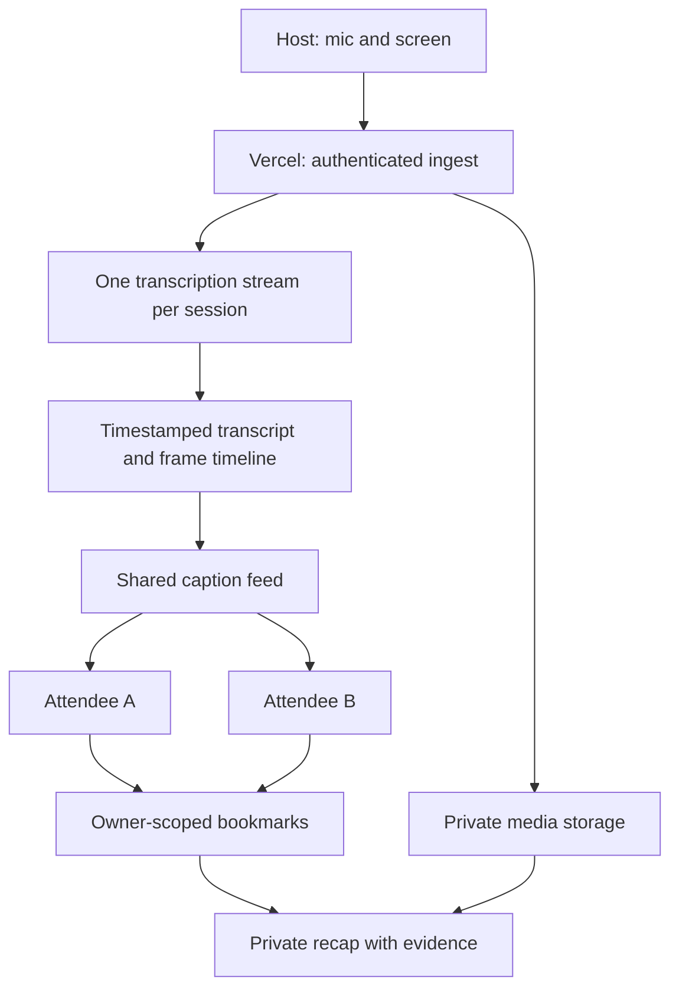

# Architecture

Status: Next.js on Vercel is confirmed. The runtime design below is proposed and unverified. See [decisions](decisions.md) for choices requiring validation.

## Data flow

## Monorepo ownership

These paths are planned, not scaffolded. Use pnpm workspaces, one lockfile, and `workspace:` dependencies.

The [building tracks](building-tracks.md) divide feature ownership, including the UI/capture boundary and shared migration coordination.

| Path | Owns |
| --- | --- |
| `apps/web` | Next.js App Router, host and attendee UI, browser capture, server routes, and Vercel deployment |
| `apps/web/src/server` | Authentication, ingest, caption delivery, provider adapters, and recap jobs |
| `packages/ui` | shadcn/ui components, theme, shared presentation primitives |
| `packages/contracts` | Runtime request/event schemas and derived TypeScript types |
| `packages/domain` | Pure timeline, selection, alignment, and revision rules |
| `packages/db` | Postgres schema, migrations, repositories, synthetic seeds |
| `infra` | Local services, deployment definitions, telemetry configuration |
| `tests/fixtures` | Authorized audio, screen frames, expected words and timestamps |
| `tests/e2e` | Host/attendee flows and cross-user isolation checks |

One Next.js application owns the UI and backend. HTTP endpoints use App Router Route Handlers; capture and interactive captions use Client Components. `domain` and `contracts` have no UI, database, or provider dependencies. Only server code imports `db` or server provider SDKs. Mark server modules with `server-only`. Keep application-specific components in web.

## Vercel runtime

Deploy `apps/web` as one Vercel project. Use Node.js functions for server work, with managed Postgres and private object storage as proposed dependencies. Persist transcript revisions, replay cursors, and session leases outside function memory. Storage vendors remain undecided.

Propose a Vercel WebSocket function for host audio and a server-side Deepgram adapter. HTTP persists bookmarks and frames; SSE distributes captions. Verify WebSocket routing alongside Next.js before committing to the transport. Vercel documents WebSocket support, but connection duration is bounded. See the [WebSocket guide](https://vercel.com/kb/guide/real-time-chat-websockets) and [function duration limits](https://vercel.com/docs/functions/configuring-functions/duration).

WebSocket support is public beta. The Next.js guide uses the Vercel-only `experimental_upgradeWebSocket` API in a Route Handler and requires `vercel dev` for local development. CLI compatibility still needs verification. Keep transport behind the ingest adapter; if milestone 1 transport checks fail, revisit the proposal before proceeding.

Function instances do not share memory. Use durable leases to fence competing hosts and a shared event source for caption delivery across instances. Select and test the event delivery mechanism in milestone 1. Reconnect audio and caption connections with backoff, cursor replay, and explicit gap reporting. Map each replacement provider connection back to the source clock; never reset session time when a function restarts. Persist transcript-finalization progress separately from durable audio acknowledgments. On reconnect, replay retained audio from the last finalized source offset and deduplicate any overlap. Expose unrecoverable transcript ranges separately from missing audio.

Recap generation needs durable status and retries. Select a Vercel-compatible job mechanism before milestone 3; do not rely on an unawaited promise after a response. Cleanup must also resume safely after interruption. Bound media uploads to platform request limits, or authorize direct private uploads and validate ownership, epoch, and metadata before accepting them.

Elasticsearch remains an optional derived index. An always-on API service and a separate deployment are outside this plan.

If search is added, purge indexed passages when their sources expire, are redacted, or are deleted. Recheck current membership and source access against Postgres before returning results, including after revocation.

## Timeline invariants

- Use one host monotonic capture clock. Map audio sample offsets, frame capture times, and provider word offsets through an ingest epoch. Never align by upload arrival time.
- Fence ingest with a host lease and epoch. Stale hosts cannot publish after replacement; one active session has one live transcription stream.
- Estimate the live session clock on attendee devices. Record uncertainty. If sync is stale, disable live marks and allow paragraph-anchored marks.
- Replace interim text; patch final segments by stable ID and revision. Replayed events must not duplicate words or undo a newer correction.
- Replay SSE from a cursor. If history expired, supply an authorized snapshot and cursor. Do not report a silent gap as caught up.
- Resolve bookmarks within fixed requested ranges. A later transcript or image arrival cannot move the range. Partial evidence remains visibly incomplete.

## Screen and audio capture

Capture mic input separately from the selected screen. A venue needs an actual mixer/interface feed. Start with an authorized USB mic and a tested presentation laptop.

Propose one screen observation per second. Deduplicate identical images but retain observation timestamps and capture health. Include the valid frame at selection start and changed frames within the interval. Preserve both slides across a transition. Display at most three representative images initially; retain access to the rest. A stopped capture invalidates later use of an old frame.

Sampling can miss short visuals. Inspect code legibility before choosing compression and dimensions. Attaching screenshots is MVP; OCR or multimodal interpretation is optional and must cite the frame separately from spoken text.

Number audio chunks, attach time ranges/checksums, and acknowledge durable writes. Proposed host resend capacity is two minutes. Exceeding it exposes a gap. Optional repair transcription creates revised segments with repaired provenance. Track audio coverage separately from transcription accuracy.

## Access, retention, and operations

- QR invitations issue distinct attendee memberships, never host credentials. Enforce session access and resource ownership on every API, search, image URL, and event stream.
- Shared captions exclude private bookmark events. Hosts do not automatically see attendees' notes or recaps. Revocation stops further authorized delivery and image access.
- Proposed expiry: shared audio, transcript, and frames 24 hours after session end; selected evidence and recaps 30 days after selection. Confirm policy before real recording.
- Materialize selected text revisions and retain authorized selected image references before shared-source expiry. Deletion and expiry jobs must handle references and invalidate dependent recaps.
- Host redaction invalidates affected hosted selections and recaps. Personal deletion does not remove others' shared source. Downloaded exports cannot be recalled.
- Keep content out of logs, telemetry, session replay, and errors. Verify provider retention controls, including Deepgram opt-out. Never claim system-wide 30-second retention.
- Measure ingest lag, caption lag, transcription failures, source gaps, durable-save latency, and recap errors. Vercel is the confirmed hosting choice; Dash0 and Elasticsearch are [under consideration](decisions.md#tools-under-consideration).

Use authenticated object access and short-lived image links. Exports embed selected images and sanitized text, with no access tokens. Source and provider text are untrusted data.
