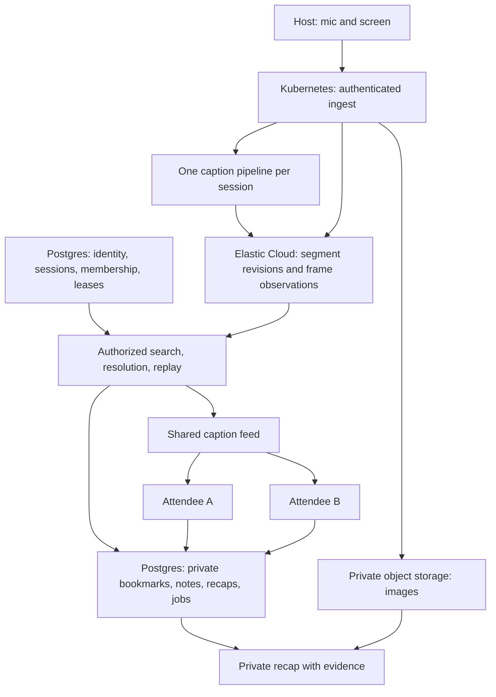
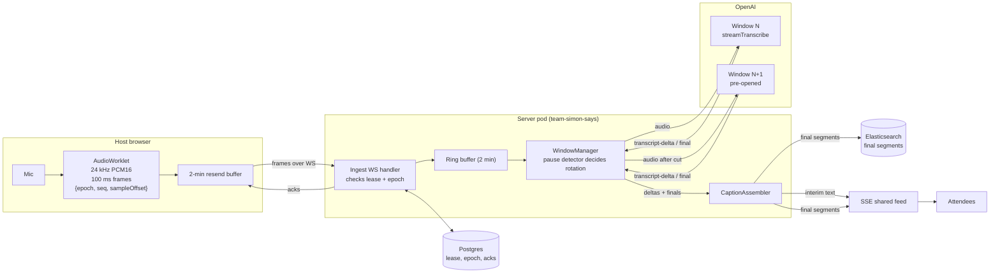

# Architecture

Status: the milestone 0 workspace foundation is complete with local verification. Next.js on Kubernetes operated through Radar and Prisma for PostgreSQL are confirmed. The team cluster is provisioned. Track 2's transcription provider, adapter direction, and Elasticsearch core-content-store split are confirmed by its owner; runtime behavior is unverified. The remaining product runtime design below is proposed. See [decisions](decisions.md) for choices requiring validation.

## Data flow

## Monorepo ownership

The workspace uses pnpm, one lockfile, and `workspace:` dependencies. The web, UI, and database foundations are scaffolded. `packages/contracts` and `packages/domain` are reserved packages with README files; their APIs remain unimplemented. Other paths and responsibilities in the table describe planned work.

The [building tracks](building-tracks.md) divide feature ownership, including the UI/capture boundary and shared migration coordination.

| Path                  | Owns                                                                                                          |
| --------------------- | ------------------------------------------------------------------------------------------------------------- |
| `apps/web`            | Next.js App Router, host and attendee UI, browser capture, server routes, and Node.js runtime                 |
| `apps/web/src/server` | Authentication, ingest, caption delivery, provider adapters, Elasticsearch ingest and reads, and durable jobs |
| `packages/ui`         | shadcn/ui components, theme, shared presentation primitives                                                   |
| `packages/contracts`  | Runtime request/event schemas and derived TypeScript types                                                    |
| `packages/domain`     | Pure timeline, selection, alignment, and revision rules                                                       |
| `packages/db`         | Prisma schema and client; planned migrations, repositories, and synthetic seeds                               |
| `infra`               | Local services, deployment definitions, telemetry configuration                                               |
| `tests/fixtures`      | Authorized audio, screen frames, expected words and timestamps                                                |
| `tests/e2e`           | Host/attendee flows and cross-user isolation checks                                                           |

One Next.js application owns the UI and backend. HTTP endpoints use App Router Route Handlers; capture and interactive captions use Client Components. `domain` and `contracts` have no UI, database, or provider dependencies. Only server code imports `db` or server provider SDKs. Mark server modules with `server-only`. Keep application-specific components in web.

## Kubernetes runtime

Deploy the existing Next.js app as a Node.js container. Radar supplies cluster visibility, investigations, and deployment operations; Kubernetes runs the app. Keep HTTP APIs in Route Handlers. A proposed custom Node entry point owns WebSocket upgrades and delegates HTTP to Next.js. Prove its packaging, development command, and graceful shutdown in checkpoint 0A; do not assume a Route Handler supports upgrades outside Vercel. A custom server must be packaged explicitly rather than assuming Next.js standalone output includes it.

Start with one application replica, but keep all leases, replay cursors, audio acknowledgments, and transcript progress durable. Rolling deployments can overlap pods. Reconnect with backoff, replay frames the host still holds, deduplicate overlap, and preserve the source clock. Pod termination must not end a session; audio beyond host resend capacity becomes a visible gap while raw-audio persistence is deferred. Keep missing audio distinct from missing transcript.

Propose a Postgres event log with bounded polling for cross-pod SSE delivery. Notification mechanisms may reduce latency but cannot replace durable replay. Validate latency and load in milestone 1. The gateway must pass WebSocket upgrades and unbuffered SSE. Bound uploads, connection counts, and backpressure; keep authorization at each boundary.

Use CloudNativePG for cluster Postgres via Prisma, with access and persistence still to verify. Elasticsearch on Elastic Cloud Serverless (hackathon trial) owns shared transcript revisions and screen observations; private object storage owns images. The team cluster budget (2 CPU / 4 GiB requests, 4 CPU / 8 GiB limits total) cannot fit Elasticsearch next to the app and Postgres. Private object storage remains a deployment decision; the local SeaweedFS setup proves only local behavior. Use runtime Secrets and explicit migration Jobs. See the [deployment plan](deployment.md) for packaging, rollout, and teardown gates.

Recap and source cleanup work need durable Postgres jobs, retries, and leases. Propose Postgres-backed jobs consumed by a worker from the same repository and image; select the library before milestone 2. Scheduled cleanup can use a Kubernetes CronJob, but progress must survive interruption. Never rely on an unawaited promise or pod-local files for durable work.

## Search and observability

Elasticsearch is the system of record for shared source content from milestone 1: every transcript segment revision with live/corrected/repaired provenance, and screen observations with capture time, frame ID, checksum, glossary terms, and private image object key. Track 2 writes these during ingest. Postgres owns identity, sessions, membership, host lease/epoch, audio acknowledgments, finalized-transcript offset, bookmarks, notes, recaps, and job queue. No private data or identity-linked search queries enter Elasticsearch.

Track 3 resolves bookmarks by `startMs`/`endMs` on the session clock against Elasticsearch, filtered to segment revisions and frames. Fixed requested ranges never move when later content arrives. Track 3 also implements “Find the Right Talk” keyword search plus `semantic_text` over segments and glossary terms; track 1 owns its UI. Confirm the embedding/inference endpoint (for example Jina) in the Elastic project before using it. Results resolve to source ranges that attendees explicitly keep as paragraph-anchored selections; search never adds evidence automatically.

Every Elasticsearch read, including search, resolution, and replay, checks current membership and access in Postgres first, including after revocation. Apply source revision, redaction, and expiry guards before returning content. Durable cleanup jobs remove expired/redacted/deleted documents and prevent retries restoring them. Materialize selected evidence before shared-source expiry.

Use idempotent document IDs based on session, epoch, segment ID, and revision; frame observations use stable observation identity. Elasticsearch persistence is part of durable source acknowledgment. Milestone 1 must settle write ordering across Elasticsearch, the Postgres finalized offset, audio acknowledgments, and replay events, including crash recovery. An Elasticsearch outage visibly degrades captions; retain/retry source content or expose a gap, never silently drop it. A search-only failure leaves captions and saved evidence usable when the content store is healthy.

Dash0 receives content-free OpenTelemetry from the Node runtime and worker. Allowlist attributes and suppress captured text, queries, notes, model prompts, credentials, and signed URLs. Disable content-bearing automatic instrumentation. Radar handles cluster operations; Dash0 handles application traces and metrics. The [hackathon plan](hackathon.md) defines evidence and ownership for all four tracks.

## Transcription and text passes

**Plan B, confirmed by Dylan on November 9, 2026:** OpenAI only, using hackathon credits. Live captions use `gpt-realtime-whisper` through server-only `ai` 7.0.x `experimental_streamTranscribe` and `@ai-sdk/openai` 4.0.x `openai.transcription(model)`. `gpt-live-transcribe` is a same-price config swap. See [pricing and SDK evidence](decisions.md#confirmed-by-the-track-2-owner). This pipeline is planned, not implemented or runtime-verified.

**Host capture:** `getUserMedia` with echo cancellation, noise suppression, and AGC off; `AudioContext({sampleRate: 24000})`; an AudioWorklet emits 2,400-sample (100 ms) PCM16 frames with `{epoch, seq, sampleOffset}`. `sampleOffset / 24` gives source-clock milliseconds. Retain a two-minute resend buffer and reconnect with backoff.

**Ingest:** the custom Node server owns WebSocket ingest, Postgres lease/epoch checks, a two-minute ring buffer, and batched acknowledgments. A duplicate `seq` in the same epoch with the same checksum is acked idempotently; changed content conflicts. Raw-audio persistence to object storage is deferred today. Acknowledgments confirm receipt into the ring buffer, not durable storage; the [contracts](contracts.md#live-caption-ingest-and-events) define this and mark the AudioChunk record deferred.

**WindowManager:** the SDK commits once when input closes and ends at its first final, so run successive windows. Rotate at the first pause of at least 300 ms after 15 s, or force at 25 s at the quietest 20 ms in the last second. Pre-open N+1 about 1 s early. Frames from the cut go to N+1; closing N's input commits it. Keep pause detection, rotation planning, and timing estimation pure in `packages/domain`; the SDK call lives in `apps/web/src/server/captions/`.

**CaptionAssembler:** deltas become interim text over SSE only, with estimated audio time per delta (offset sent minus measured lag). The final replaces interim text. Split it into sentences with estimated ranges (about ±1–2 s, `timing: "estimated"`), writing revision 1 to Elasticsearch with provenance `live` and idempotent ID `session:epoch:window:sentence:rev`. Publish captions in window order. Persist final content before advancing the Postgres finalized offset or publishing durable final events; settle cross-store ordering and crash recovery in milestone 1.

**Failures:** replay a failed window from the ring buffer up to two retries, then emit a gap event `[startMs, endMs]`. On host drops, the host resends frames the server has not acknowledged. Acknowledgment is receipt into the server ring buffer, not durable storage (see [contracts](contracts.md#live-caption-ingest-and-events)), and the host discards acknowledged frames. So on pod restart, acknowledged audio that was not yet finalized is lost: the new pod resumes transcription at the first frame the host still holds and emits a `caption.gap` (`audio_missing`) from the last finalized offset to that frame. Do not claim acknowledged audio survives restart without durable bytes. Show lag in caption health and Dash0.

**Limits and validation:** no live vocabulary hints: streaming prompt and keywords warn as unsupported. There are no SDK segment timestamps (`segments: []`); timing is estimated. Use one replica for in-process SSE fan-out; multiple replicas require the shared event source described above, including during rolling overlap. Unverified until a key exists: session length limits, faster-than-realtime replay, final/delta differences, latency per `delay`, and rate limits. Start `providerOptions.openai.streaming.delay` at `low`; supported choices are `minimal|low|medium|high|xhigh`. Test pure domain logic and fake transcription models without a key; make the first real call in the cluster with the key in the Secret.

**Dash0:** one span per window; content-free interim and final caption lag, rotation gap, window duration, retries, errors, ingest backlog, reconnects, and Elasticsearch write latency. Never audio, text, or prompts.

**Proposed glossary and correction, milestones 2–3:** OpenAI through the AI SDK, using the cheapest OpenAI model that passes the check, chosen at implementation. Extract terms from changed frames; correct finalized captions asynchronously with new `corrected` revisions and preserved originals. Both passes stay off the live caption path. Screen and transcript text are untrusted data, never instructions.

## Timeline invariants

- Use one host monotonic capture clock. Map audio sample offsets and frame capture times through an ingest epoch. Stamp transcript ranges from sent audio offsets, not provider timestamps. Never align by upload arrival time.
- Fence ingest with a host lease and epoch. Stale hosts cannot publish after replacement; one active session has one caption pipeline with successive transcription windows.
- Estimate the live session clock on attendee devices. Record uncertainty. If sync is stale, disable live marks and allow paragraph-anchored marks.
- Replace interim text; patch final segments by stable ID and revision. Replayed events must not duplicate words or undo a newer correction.
- Replay SSE from a cursor. If history expired, supply an authorized snapshot and cursor. Do not report a silent gap as caught up.
- Resolve bookmarks against Elasticsearch segment revisions and frames within fixed requested `startMs`/`endMs` ranges after a current Postgres access check. A later transcript or image arrival cannot move the range. Partial evidence remains visibly incomplete.

## Screen and audio capture

Capture mic input separately from the selected screen. A venue needs an actual mixer/interface feed. Start with an authorized USB mic and a tested presentation laptop.

Propose one screen observation per second. Deduplicate identical images but retain observation timestamps and capture health. Include the valid frame at selection start and changed frames within the interval. Preserve both slides across a transition. Display at most three representative images initially; retain access to the rest. A stopped capture invalidates later use of an old frame.

Sampling can miss short visuals. Inspect code legibility before choosing compression and dimensions. Attaching screenshots is MVP; OCR or multimodal interpretation is optional and must cite the frame separately from spoken text.

Number audio frames, attach source offsets/checksums, and distinguish receipt acks from final-content persistence. Host resend capacity is two minutes; raw-audio object persistence is deferred today. Exceeding it exposes a gap. Optional repair transcription creates revised segments with repaired provenance. Track audio coverage separately from transcription accuracy.

## Access, retention, and operations

- QR invitations issue distinct attendee memberships, never host credentials. Enforce session access and resource ownership on every API, search, image URL, and event stream.
- Shared captions exclude private bookmark events. Hosts do not automatically see attendees' notes or recaps. Revocation stops further authorized delivery and image access.
- Proposed expiry: shared audio, transcript, and frames 24 hours after session end; selected evidence and recaps 30 days after selection. Confirm policy before real recording.
- Materialize selected text revisions and retain authorized selected image references before shared-source expiry. Deletion, redaction, and expiry jobs must durably resume Elasticsearch document cleanup, handle object references, and invalidate dependent recaps.
- Host redaction invalidates affected hosted selections and recaps. Personal deletion does not remove others' shared source. Downloaded exports cannot be recalled.
- Keep content out of logs, telemetry, session replay, and errors. Verify provider retention controls, including provider data-use opt-out where available. Never claim system-wide 30-second retention.
- Measure ingest lag, caption lag, transcription failures, source gaps, durable-save latency, and recap errors. Verify Dash0 telemetry with real requests and inspect exported payloads for content leaks.

Use authenticated object access and short-lived image links. Exports embed selected images and sanitized text, with no access tokens. Source and provider text are untrusted data.
