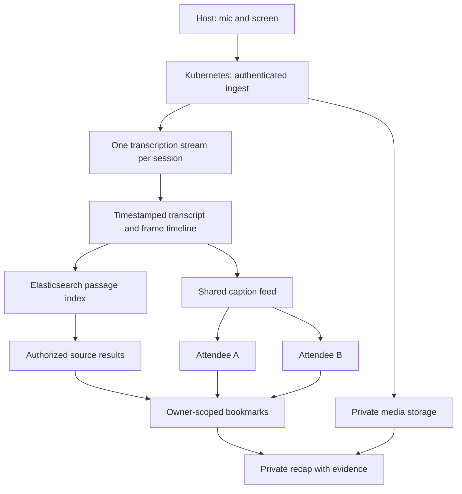

# Architecture

Status: the milestone 0 workspace foundation is complete with local verification. Next.js on Kubernetes operated through Radar and Prisma for PostgreSQL are confirmed. Cluster access is pending. The product runtime design below remains proposed and unverified. See [decisions](decisions.md) for choices requiring validation.

## Data flow

## Monorepo ownership

The workspace uses pnpm, one lockfile, and `workspace:` dependencies. The web, UI, and database foundations are scaffolded. `packages/contracts` and `packages/domain` are reserved packages with README files; their APIs remain unimplemented. Other paths and responsibilities in the table describe planned work.

The [building tracks](building-tracks.md) divide feature ownership, including the UI/capture boundary and shared migration coordination.

| Path                  | Owns                                                                                           |
| --------------------- | ---------------------------------------------------------------------------------------------- |
| `apps/web`            | Next.js App Router, host and attendee UI, browser capture, server routes, and Node.js runtime  |
| `apps/web/src/server` | Authentication, ingest, caption delivery, provider adapters, search/indexing, and durable jobs |
| `packages/ui`         | shadcn/ui components, theme, shared presentation primitives                                    |
| `packages/contracts`  | Runtime request/event schemas and derived TypeScript types                                     |
| `packages/domain`     | Pure timeline, selection, alignment, and revision rules                                        |
| `packages/db`         | Prisma schema and client; planned migrations, repositories, and synthetic seeds                |
| `infra`               | Local services, deployment definitions, telemetry configuration                                |
| `tests/fixtures`      | Authorized audio, screen frames, expected words and timestamps                                 |
| `tests/e2e`           | Host/attendee flows and cross-user isolation checks                                            |

One Next.js application owns the UI and backend. HTTP endpoints use App Router Route Handlers; capture and interactive captions use Client Components. `domain` and `contracts` have no UI, database, or provider dependencies. Only server code imports `db` or server provider SDKs. Mark server modules with `server-only`. Keep application-specific components in web.

## Kubernetes runtime

Deploy the existing Next.js app as a Node.js container. Radar supplies cluster visibility, investigations, and deployment operations; Kubernetes runs the app. Keep HTTP APIs in Route Handlers. A proposed custom Node entry point owns WebSocket upgrades and delegates HTTP to Next.js. Prove its packaging, development command, and graceful shutdown in checkpoint 0A; do not assume a Route Handler supports upgrades outside Vercel. A custom server must be packaged explicitly rather than assuming Next.js standalone output includes it.

Start with one application replica, but keep all leases, replay cursors, audio acknowledgments, and transcript progress durable. Rolling deployments can overlap pods. Reconnect with backoff, replay from the last finalized source offset, deduplicate overlap, and preserve the source clock. Pod termination must not end a session or silently discard acknowledged audio. Keep missing audio distinct from missing transcript.

Propose a Postgres event log with bounded polling for cross-pod SSE delivery. Notification mechanisms may reduce latency but cannot replace durable replay. Validate latency and load in milestone 1. The gateway must pass WebSocket upgrades and unbuffered SSE. Bound uploads, connection counts, and backpressure; keep authorization at each boundary.

Propose CloudNativePG for cluster Postgres, subject to access and persistence verification. Private object storage remains a deployment decision; the local SeaweedFS setup proves only local behavior. Use runtime Secrets and explicit migration Jobs. See the [deployment plan](deployment.md) for packaging, rollout, and teardown gates.

Recap and indexing work need durable jobs, retries, and leases. Propose Postgres-backed jobs consumed by a worker from the same repository and image; select the library before milestone 2. Scheduled cleanup can use a Kubernetes CronJob, but progress must survive interruption. Never rely on an unawaited promise or pod-local files for durable work.

## Search and observability

Elasticsearch passage search is required hackathon scope after private highlights work. Postgres remains authoritative. Index finalized shared transcript passages with session, source range, segment IDs, revisions, and expiry; never index private notes or recaps. Use keyword search first, then semantic search with an explicitly selected inference endpoint. Elastic Cloud Serverless is proposed to avoid adding a search cluster to the application cluster.

Search returns candidates. Recheck membership, current source revisions, redaction, and expiry in Postgres before exposing text or accepting a selection. Search selection uses the existing paragraph bookmark path and source clock. Durable indexing jobs update revisions and purge expired or removed passages; an index outage must not interrupt capture or private saves. Search never silently adds evidence to a recap.

Dash0 receives content-free OpenTelemetry from the Node runtime and worker. Allowlist attributes and suppress captured text, queries, notes, model prompts, credentials, and signed URLs. Disable content-bearing automatic instrumentation. Radar handles cluster operations; Dash0 handles application traces and metrics. The [hackathon plan](hackathon.md) defines evidence and ownership for all four tracks.

## Timeline invariants

- Use one host monotonic capture clock. Map audio sample offsets, frame capture times, and provider word offsets through an ingest epoch. Never align by upload arrival time.
- Fence ingest with a host lease and epoch. Stale hosts cannot publish after replacement; one active session has one live transcription stream.
- Estimate the live session clock on attendee devices. Record uncertainty. If sync is stale, disable live marks and allow paragraph-anchored marks.
- Replace interim text; patch final segments by stable ID and revision. Replayed events must not duplicate words or undo a newer correction.
- Replay SSE from a cursor. If history expired, supply an authorized snapshot and cursor. Do not report a silent gap as caught up.
- Resolve bookmarks within fixed requested ranges. A later transcript or image arrival cannot move the range. Partial evidence remains visibly incomplete.

## Screen and audio capture

Capture mic input separately from the selected screen. A venue needs an actual mixer/interface feed. Start with an authorized USB mic and a tested presentation laptop.

Propose one screen observation per second. Deduplicate identical images but retain observation timestamps and capture health. Include the valid frame at selection start and changed frames within the interval. Preserve both slides across a transition. Display at most three representative images initially; retain access to the rest. A stopped capture invalidates later use of an old frame.

Sampling can miss short visuals. Inspect code legibility before choosing compression and dimensions. Attaching screenshots is MVP; OCR or multimodal interpretation is optional and must cite the frame separately from spoken text.

Number audio chunks, attach time ranges/checksums, and acknowledge durable writes. Proposed host resend capacity is two minutes. Exceeding it exposes a gap. Optional repair transcription creates revised segments with repaired provenance. Track audio coverage separately from transcription accuracy.

## Access, retention, and operations

- QR invitations issue distinct attendee memberships, never host credentials. Enforce session access and resource ownership on every API, search, image URL, and event stream.
- Shared captions exclude private bookmark events. Hosts do not automatically see attendees' notes or recaps. Revocation stops further authorized delivery and image access.
- Proposed expiry: shared audio, transcript, and frames 24 hours after session end; selected evidence and recaps 30 days after selection. Confirm policy before real recording.
- Materialize selected text revisions and retain authorized selected image references before shared-source expiry. Deletion and expiry jobs must handle references and invalidate dependent recaps.
- Host redaction invalidates affected hosted selections and recaps. Personal deletion does not remove others' shared source. Downloaded exports cannot be recalled.
- Keep content out of logs, telemetry, session replay, and errors. Verify provider retention controls, including Deepgram opt-out. Never claim system-wide 30-second retention.
- Measure ingest lag, caption lag, transcription failures, source gaps, durable-save latency, and recap errors. Verify Dash0 telemetry with real requests and inspect exported payloads for content leaks.

Use authenticated object access and short-lived image links. Exports embed selected images and sanitized text, with no access tokens. Source and provider text are untrusted data.
